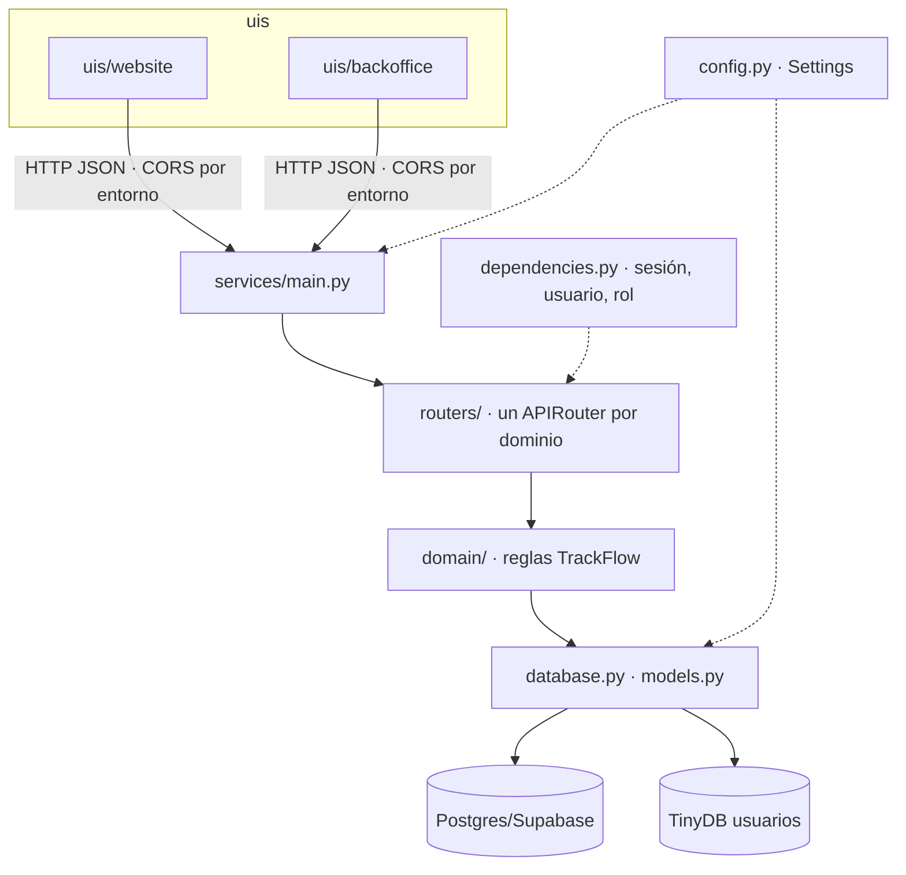

# Solución — Propuesta de Arquitectura de Backend

> Proyecto: [`ai-eng-architectural-proposal`](https://github.com/4GeeksAcademy/ai-engineering-syllabus/blob/main/content/projects/ai-eng-architectural-proposal/README.es.md) · Empresa: **TrackFlow** · Autor: Samuel Bolivar ([@sabw14](https://github.com/sabw14))
> Estado: `en revisión` · Rama: `feature/propuesta-arquitectura-backend`
> Repo de entrega: [4GeeksAcademy/sabw14-ai-engineering-company-project-TrackFlow](https://github.com/4GeeksAcademy/sabw14-ai-engineering-company-project-TrackFlow) · rama `feature/propuesta-arquitectura-backend`

## 1. Resumen

El CTO pidió un documento de arquitectura **antes** de escribir código del backend. Se entrega [`docs/ARCHITECTURE_PROPOSAL.md`](../ARCHITECTURE_PROPOSAL.md), que propone:

- **Patrón:** arquitectura en capas por dominio (monolito modular) en un solo servicio FastAPI (routers → `domain/` → datos). Se justifica con el carácter contractual del stock, un roadmap que crece por dominios, un equipo de 7 personas y la operación 24/7. Serverless y microservicios quedan descartados con sus motivos.
- **Estructura** en `services/`, compatible con las rutas literales del briefing del Hito 5, y una regla de evolución a paquetes por dominio.
- **Routers por dominio** con tablas de rutas: inventario (literal del Hito 5), auth, leads y health, más los dominios futuros.
- **Investigación de FastAPI** con fuentes citadas: docs oficiales, plantilla full-stack oficial y una guía de la comunidad.
- **Separación entre frontend y backend:** monorepo con despliegues separados, contrato OpenAPI, CORS por entorno (incluido el caso de Codespaces) y variables de entorno.
- **Decisiones D-09 a D-17** y **9 riesgos** con impacto y mitigación.
- **Revisión independiente** como evaluador de 4Geeks: aprobada frente a la rúbrica; se corrigieron 5 bloqueantes para el Hito 5 y 8 recomendaciones (sección 8).

No se instala FastAPI ni se escribe código: el enunciado evalúa el razonamiento.

## 2. Contexto aplicado

- Briefings usados: [`BRIEFING.md`](../../BRIEFING.md) (empresa) y el briefing del Hito 5 (`contexts/05-backend-development/trackflow-BRIEFING.es.md` del syllabus).

| Dato del briefing | Dónde se aplica en la propuesta |
|---|---|
| Stock contractual; "Esta es la base de todo" (TRK-0341) | §1 y §2: la justificación del patrón y de la capa de dominio |
| `current_stock: int` calculado, nunca almacenado; cada SKU tiene su `warehouse` (semilla `CLT-SNK-W-42` en LA y `CLT-SNK-W-42-Z` en ZGZ) | D-13, D-14 y riesgo R2 |
| `HTTP 400` con un mensaje literal si la salida deja el stock negativo; rechazar antes de escribir | §4 (el router traduce la excepción del dominio con el mensaje literal), D-15 y riesgo R3 |
| `tracking_number` obligatorio en `dispatch` y nulo en `loss` | Validador del schema → `422` (D-16; el briefing lo permite "en el schema") |
| Usuarios en TinyDB, sin tabla de usuarios en Supabase | D-12 y riesgos R4 y R7 |
| `database.py` con la dependencia `get_db` | §3 (se usa el nombre del briefing) |
| Archivos `services/main.py`, `database.py`, `models.py`, `schemas.py`, `routers/inventory.py` | §3: estructura literal y conflicto D-09 |
| Las 6 rutas bajo `/inventory` | §4: tabla literal |
| `user_uuid` en `StockEntry` y `StockExit`; el briefing no pide autenticación | §4: el Hito 5 va **sin autenticación** y con `user_uuid` en el cuerpo; los roles llegan después |
| Roles **Empleado**, **Supervisor** y **Admin** (briefing de roles y permisos) | §4: hitos posteriores; no se inventan roles |
| 2 almacenes, operación 24/7, equipo de 7 personas | §2: justificación y alternativas descartadas |
| Formulario de leads del Hito 1 (12 campos) | §4: dominio `leads` sin fecha y con `TODO(briefing)` (datos personales) |

## 3. Arquitectura

La arquitectura que se propone para el backend (resumen de §2 a §6 del documento):



### Estructura de archivos de este entregable

```text
docs/ARCHITECTURE_PROPOSAL.md            # entregable
docs/soluciones/ai-eng-architectural-proposal.md
CONTEXT.md                               # índice: leer la propuesta antes de tocar services/
services/README.md · README.es.md        # enlace a la propuesta
memory-bank/progress.md                  # Hitos 1 y 4 hechos; propuesta en curso; conflicto D-09
```

## 4. Decisiones técnicas

Las decisiones de arquitectura están en §7 del documento (D-09 a D-17). Sobre la forma del entregable:

| Decisión | Alternativas | Motivo |
|---|---|---|
| Respetar literalmente la ubicación del briefing del Hito 5 (`services/main.py`, `services/routers/inventory.py`) | Proponer `services/trackflow-api/` o `app/` | El evaluador del Hito 5 buscará esas rutas; la regla `fidelidad-briefing` manda sobre la estructura |
| Dejar D-09 como **propuesta** y no cambiar todavía la regla `estructura-monorepo` | Cambiar la regla en este PR | Es un borrador para que el CTO lo apruebe; la regla de dependencias exige aprobación para cambiar `.agents/**` |
| Empezar organizando **por capa** y migrar **por dominio** con una regla objetiva (300 líneas o 3 dominios con tablas) | Paquetes por dominio desde el día 1 | Con un solo dominio, la estructura por capa es la del briefing y la de la guía oficial; la regla evita discutir cuándo migrar |
| Citar fuentes primarias (docs de FastAPI y plantilla oficial) y marcar la guía de la comunidad como opinión | Citar de memoria | El criterio de evaluación pide mencionar explícitamente el origen de las convenciones |
| Señalar la contradicción del ejemplo de CORS de FastAPI | Copiar el ejemplo oficial | El ejemplo combina `allow_credentials=True` con `"*"`, que la referencia prohíbe |
| Dominios futuros solo con criterio de ubicación, sin rutas inventadas | Detallar `/carriers` y `/returns` | Sin briefing, sus campos serían inventados (regla `fidelidad-briefing`) |

## 5. Prompts que resuelven la tarea

Ejecutados en local con Claude Code sobre el monorepo, en la rama `feature/propuesta-arquitectura-backend`.

### Prompt 1 — Lectura

**Contexto:** el enunciado, su solución de referencia y su ejemplo (`.learn/`), `BRIEFING.md`, el `memory-bank/` y el briefing del Hito 5.

```text
Lee el enunciado de ai-eng-architectural-proposal, su checklist de revisores y el ejemplo de
clase. Lee BRIEFING.md, memory-bank/ y el briefing del Hito 5 de TrackFlow (API de
inventario). Extrae: requisitos del entregable, criterios de evaluación, entidades, rutas,
ubicación de archivos y reglas de negocio del Hito 5, y cualquier conflicto con las reglas
de .agents/. No escribas todavía.
```

- **Produce:** el plan. Detectó el conflicto entre `services/routers/inventory.py` (briefing del Hito 5) y la regla `services/<nombre>/`.

### Prompt 2 — Investigación (agente de lectura web)

```text
Lee y resume con citas exactas y URL: FastAPI "Bigger Applications", "Settings and
Environment Variables", "CORS", "SQL (Relational) Databases" y "Dependencies"; la
estructura de backend/app de fastapi/full-stack-fastapi-template; y la sección
de estructura de zhanymkanov/fastapi-best-practices (organización por dominio y su
justificación). Indica lo que no hayas podido verificar.
```

- **Produce:** convenciones citables. Detectó que el ejemplo de CORS de FastAPI contradice su propia referencia sobre `"*"` con credenciales, y que la guía de la comunidad es de opinión.

### Prompt 3 — Actualizar el contexto

```text
Crea la rama feature/propuesta-arquitectura-backend desde main. Actualiza
memory-bank/progress.md: Hitos 1 y 4 en main (#3, #4), la propuesta en curso, los próximos
pasos (aprobación del CTO → D-09) y aprendizajes (comprobar con gh que un PR está mergeado;
el conflicto de ubicación de services/). Commit aparte.
```

### Prompt 4 — Redactar la propuesta

```text
Escribe docs/ARCHITECTURE_PROPOSAL.md dirigido al CTO Andrés Kim, en español y sin código, con:
§1 contexto de negocio → exigencias para el backend (tabla vinculada al briefing);
§2 patrón en capas por dominio, con su justificación ligada a TrackFlow, las alternativas
   descartadas (serverless, microservicios, todo en main.py) y la compensación aceptada;
§3 estructura de services/ compatible con las rutas literales del Hito 5, con una tabla de
   responsabilidades, el criterio de separación y una regla objetiva de evolución por dominio,
   y el conflicto con estructura-monorepo como decisión D-09 propuesta;
§4 routers por dominio: tablas de rutas (las de inventario, literales), roles por ruta,
   criterios (prefix/tags/dependencies) y OpenAPI como contrato;
§5 tabla convención → fuente con URL → cómo se aplica;
§6 monorepo con despliegues separados, diagrama, códigos HTTP, URL base por variable de
   entorno, CORS con orígenes explícitos por entorno (incluido el puerto 8000 público en
   Codespaces) y tabla de variables con valores ficticios;
§7 decisiones D-09 a D-17 y próximos pasos;
§8 al menos 6 riesgos con impacto en TrackFlow y mitigación.
Sin versiones inventadas ni rutas detalladas para dominios sin briefing.
```

- **Produce:** `docs/ARCHITECTURE_PROPOSAL.md`, el índice en `CONTEXT.md` y el enlace en `services/README*`.

### Prompt 5 — Revisión independiente (agente revisor)

```text
Actúa como revisor estricto de 4Geeks (solo lectura). Evalúa docs/ARCHITECTURE_PROPOSAL.md
contra cada criterio de "Qué vamos a evaluar" y del checklist de revisores. Señala errores
técnicos (FastAPI, SQLModel, CORS, Codespaces, Supabase, TinyDB), contradicciones con el
briefing del Hito 5 y del de la empresa, incoherencias internas y exceso de alcance. Da tu
veredicto y una lista priorizada de cambios.
```

- **Resultado y correcciones:** sección 8.

### Prompt 6 — Aplicar la revisión

```text
Reescribe docs/ARCHITECTURE_PROPOSAL.md aplicando la revisión:
- Hito 5 sin autenticación y user_uuid en el cuerpo, como el briefing; roles solo del briefing de
  roles y permisos (Empleado, Supervisor, Admin), comprobados por endpoint en el hito de auth;
- current_stock como int del SKU en su almacén, y rechazo de movimientos de otro almacén
  (marcado como interpretación);
- tracking_number en el schema (422) y stock en el dominio (400), con una tabla de errores;
- get_db como en el briefing; services/BRIEFING.md en el árbol;
- D-09 que actualice a la vez el README de services, la regla, techContext y el script;
- CORS sin allow_credentials (Bearer), GET/POST, orígenes de Codespaces por subdominio y
  construidos desde sus variables, y el comando para hacer público el puerto;
- riesgo de TinyDB (concurrencia, .gitignore);
- R5 y R8 sin afirmaciones falsas; referencias de sección corregidas; desviación /api/v1
  explícita; herramientas fuera del curso como "propuestas".
```

## 6. Cómo ejecutar

No hay nada que ejecutar: es un documento. Se lee en GitHub o en el editor (renderiza los diagramas mermaid).

```bash
```

## 7. Verificación en Codespaces

| Comprobación | Resultado | Evidencia |
|---|---|---|
| `docs/ARCHITECTURE_PROPOSAL.md` se ve bien en GitHub (tablas y mermaid) | pendiente | |

## 8. Pruebas y evidencias

### Revisión independiente (agente revisor sin contexto previo)

**Veredicto:** *"Aprobaría la entrega tal cual frente a la rúbrica"*. Los 6 criterios de "Qué vamos a evaluar" se cumplen, y la investigación de FastAPI (§5) y el vínculo con el negocio (§1 y §2) quedan por encima de la referencia. Señaló defectos que habrían hecho fallar el Hito 5; se corrigieron todos:

| Hallazgo | Tipo | Corrección |
|---|---|---|
| Autenticación obligatoria en `/inventory`: el evaluador del Hito 5 llama sin token y espera `400`; roles "Administrador" y "Rol comercial" inventados | Bloqueante | Hito 5 sin autenticación y `user_uuid` en el cuerpo, según el briefing. Roles reales del briefing de roles y permisos (Empleado, Supervisor y Admin), comprobados por endpoint con `require_role` en un hito posterior |
| `current_stock` como diccionario `{"LA": n, "ZGZ": m}`, que contradice el `int` del briefing y su modelo (un SKU por almacén) | Bloqueante | D-13: `int` del SKU en su almacén; D-14: rechazar movimientos de otro almacén (interpretación marcada para confirmar). El test de R2 usa la semilla |
| `tracking_number`: el texto lo ponía en el dominio (`400`) y los tests esperaban `422` | Bloqueante | D-16: validador del schema → `422`; stock en el dominio → `400`. Tabla de errores en §4 |
| D-09 no contemplaba `services/README.md`, `techContext.md` (que fallaríaría con `routers/` sin README); faltaba `services/BRIEFING.md` | Bloqueante | D-09 actualiza los cuatro a la vez; `BRIEFING.md` en el árbol; R9 ya no dice que el script mitiga |
| Dependencia `get_session` en lugar de `get_db` (briefing) | Bloqueante | `get_db` |
| Referencias "§4" que debían ser §5; "todo en `main.py`" apuntaba a R1 | Recomendable | Corregidas |
| `allow_credentials=True` con token Bearer; `PATCH` sin endpoints; "difieren por puerto" en Codespaces | Recomendable | `allow_credentials=False`, `GET`/`POST`, diferencia por **subdominio**, preflight a cargo del middleware |
| Cómo hacer público el puerto y cómo construir el origen de Codespaces | Recomendable | `gh codespace ports visibility 8000:public`; orígenes desde `CODESPACE_NAME` y `GITHUB_CODESPACES_PORT_FORWARDING_DOMAIN` |
| TinyDB no es seguro ante escrituras concurrentes y el archivo de usuarios podía acabar en git | Recomendable | Nuevo R7: *lock*, un proceso y `services/.data/` en `.gitignore` |
| R8 decía que el script detecta claves de Supabase (falso); R5 decía que `/health` comprueba CORS (imposible) | Recomendable | Corregidos; ampliar el script queda como próximo paso |
| Dos frontends en `:3000`; `config.js` "generado" en una web sin build; `NEXT_PUBLIC_*` sin framework decidido | Recomendable | Backoffice en `:3001`; `config.js` versionado que calcula la URL en el navegador; framework a decidir en el Hito 3 |
| `/health` en dos sitios; `workers/` ambiguo; leads sin persistencia definida | Recomendable | Solo en `routers/health.py`; `workers/` fuera de la API; leads como `TODO(briefing)` |
| No se reconocía la desviación de `/api/v1` frente a la plantilla oficial | Recomendable | Explícito en §4 y §5 |
| Herramientas no vistas en el curso (pydantic-settings, pytest, Alembic) presentadas como stack | Recomendable | D-11 las marca como **propuestas** |

## 9. Checklist "Qué evaluaremos"

- [x] Patrón justificado con argumentos de TrackFlow (stock contractual por almacén, roadmap por dominios, 7 personas, 24/7), no con preferencias genéricas: §1 y §2.
- [x] Estructura de carpetas coherente con el patrón y con separación clara de responsabilidades (capas) y dominios: §3.
- [x] Organización de routers reconocible como FastAPI válido: un `APIRouter` por dominio con `prefix` y `tags`, `include_router` y nada en un único archivo: §3 y §4.
- [x] Decisiones concretas y justificadas, coherentes con el curso (FastAPI, SQLModel, Pydantic): §7.
- [x] Investigación real sobre la estructura estándar de FastAPI, con su origen citado explícitamente: §5.
- [x] Frontend y backend como sistemas separados: comunicación por API, CORS y variables de entorno: §6.
- [x] Al menos 2 riesgos con mitigación (hay 9): §8.
- [x] Archivo en `docs/ARCHITECTURE_PROPOSAL.md`.
- [ ] PR mergeado a `main` y enlace entregado en el campus.

## 10. Feedback del revisor e iteraciones

| Fecha | Feedback (literal) | Cambio realizado | Commit / PR |
|---|---|---|---|
| | | | |

## 11. Aprendizajes y pendientes

- Un briefing de un hito posterior puede contradecir una regla del repo escrita antes. La propuesta es el lugar para resolverlo de forma explícita, en lugar de que cada hito elija por su cuenta.
- Pendiente tras la aprobación: enmendar `estructura-monorepo` (D-09) y registrar D-10 a D-17 en `techContext.md`.
