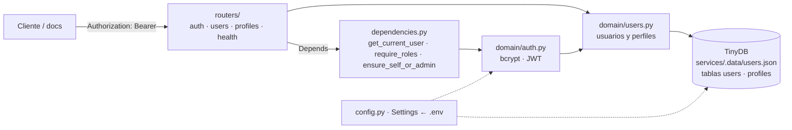

# Solución — #18 · Asegurando la API: autenticación y restricción de rutas en FastAPI

> Proyecto: [`ai-eng-user-authentication-api`](https://github.com/4GeeksAcademy/ai-engineering-syllabus/blob/main/content/projects/ai-eng-user-authentication-api/README.es.md) · Empresa: **TrackFlow** · Autor: Samuel Bolivar ([@sabw14](https://github.com/sabw14))
> Estado: `en revisión` · Rama: `feature/auth-api` (nombre exigido por el enunciado)
> Repo de entrega: [4GeeksAcademy/sabw14-ai-engineering-company-project-TrackFlow](https://github.com/4GeeksAcademy/sabw14-ai-engineering-company-project-TrackFlow) · rama `feature/auth-api`

## 1. Resumen

Ticket AUTH-01: ninguna ruta que exponga o modifique datos sensibles debe ser accesible sin una sesión válida. Se construyó la capa de autenticación de la TrackFlow API en `services/`, que es la primera implementación del backend (decisión D-09 de la propuesta de arquitectura):

- **`User`** (solo credenciales) y **`Profile`** (nombre, teléfono, dirección; 1 a 1 por `user_id`), **ambos en TinyDB**.
- **`/users`**: registro público (rol `user` por defecto, con su perfil creado en la misma operación), y listado, consulta, actualización y borrado protegidos.
- **`/profiles/me`** para leer y editar el perfil propio; **`/auth/login`** (JSON), **`/auth/token`** (formulario OAuth2 para el botón *Authorize* de `/docs`) y **`/auth/me`**.
- **JWT** HS256 con `python-jose`, que lleva el `id` de TinyDB en `sub` y expira según `ACCESS_TOKEN_EXPIRE_MINUTES`. **bcrypt** con `libpass`.
- **`get_current_user`** devuelve `401` si el token falta, está mal formado, tiene otra firma o ha expirado, y si el usuario fue eliminado o está inactivo. **`403`** al acceder a otro usuario o al intentar subirse el rol.
- **22 tests** de contrato HTTP en verde y el flujo probado contra el servidor real.

## 2. Contexto aplicado

| Requisito / dato | Dónde se aplica |
|---|---|
| `User` y `Profile` solo en TinyDB; el resto de módulos usa `user_uuid` = `id` de TinyDB | `services/domain/users.py`; propuesta de arquitectura (D-12, R4) |
| Roles `admin`, `manager` y `user`; `user` por defecto | `schemas.Role` (otro valor → `422`); `UserCreate` no acepta `role` |
| Usuarios de TrackFlow (Ana Whitfield, Sofía Ramos, Andrés Kim…) | Datos ficticios de los tests y de la prueba manual (`*@trackflow.example`) |
| Sin cookies ni sesiones; JWT stateless | `OAuth2PasswordBearer` + cabecera `Authorization: Bearer`; CORS con `allow_credentials=False` (D-17) |
| Clave de firma y expiración por entorno | `config.Settings` (`SECRET_KEY` sin valor por defecto, mínimo 32 caracteres) |
| `uv add`, nunca `pip install` | `services/pyproject.toml` + `uv.lock`, versiones exactas y `exclude-newer` (D-06) |

## 3. Arquitectura



### Estructura de archivos

```text
services/
├── main.py · config.py · cors.py · database.py · dependencies.py · schemas.py
├── routers/{auth,users,profiles,health}.py
├── domain/{auth,users}.py
├── seed_admin.py
├── tests/{conftest,test_auth_api}.py
├── pyproject.toml · uv.lock · .python-version · .env.example
└── README.es.md · README.md
```

### Rutas y protección

| Ruta | Acceso | Sin token | Otro usuario |
|---|---|---|---|
| `POST /users` | Pública (registro) | — | — |
| `GET /users` | admin o manager | `401` | `403` para el rol `user` |
| `GET /users/{id}` | El propio usuario o un admin | `401` | `403` |
| `PUT /users/{id}` | El propio usuario o un admin; `role` e `is_active` solo admin | `401` | `403` |
| `DELETE /users/{id}` | El propio usuario o un admin (borra también el perfil) | `401` | `403` |
| `GET /profiles/me`, `PUT /profiles/me` | Dueño (siempre el usuario del token) | `401` | — |
| `POST /auth/login`, `POST /auth/token` | Pública | — | — |
| `GET /auth/me` | Autenticado | `401` | — |
| `GET /health` | Pública | — | — |

> Criterio "al menos 5 rutas existentes fuera de `/users` y `/auth`": en este punto la API no tiene más rutas que `/health`. Se cumple con las **6 rutas de `/inventory`** del Hito 5 (rama `feature/inventory-api`), todas con `get_current_user`. El #18 se entrega en el campus cuando el Hito 5 esté en `main`.

## 4. Decisiones técnicas

| Decisión | Alternativas | Motivo |
|---|---|---|
| `/auth/login` con JSON **y** `/auth/token` con formulario OAuth2 | Solo el formulario | El enunciado pide que login acepte `email` y `password`; el botón *Authorize* de `/docs` necesita el formulario (`username` = email) |
| El registro público ignora `role` (`extra="forbid"` → `422`) | Aceptar `role` y forzarlo a `user` | Rechazar explícitamente impide escalar privilegios en silencio |
| `GET /users` solo para admin o manager | Cualquier usuario autenticado | Listar todos los emails es un dato sensible |
| Login con tiempo constante (se verifica un hash ficticio si el email no existe) y mensaje único | Mensajes distintos | No revela qué emails están registrados |
| `get_current_user` relee el usuario de TinyDB en cada petición | Confiar solo en el token | Un usuario eliminado o desactivado pierde el acceso al instante (hay un test) |
| `threading.Lock` en las escrituras de TinyDB | Sin lock | TinyDB no es seguro ante escrituras concurrentes en el threadpool de FastAPI (R7) |
| `seed_admin.py` desde variables de entorno | Endpoint para crear admins | El primer admin no puede venir del registro público |
| Contraseñas de 8 a 72 caracteres | Sin límite | bcrypt solo usa 72 bytes |
| `uv` con `--bounds exact` y `exclude-newer` | Rangos `>=` | D-05 y D-06: builds reproducibles y versiones con al menos 3 días |

## 5. Prompts que resuelven la tarea

Ejecutados en local con Claude Code sobre el monorepo, en la rama `feature/auth-api`.

### Prompt 1 — Lectura y orden

```text
Lee los enunciados del Hito 5 (backend) y de ai-eng-user-authentication-api. Indica las
dependencias entre ellos: el Hito 5 exige que exista la auth TinyDB (User/get_current_user) y
el #18 exige 5 rutas protegidas fuera de /users y /auth. Propón el orden de PRs y lo que
cambia en docs/ARCHITECTURE_PROPOSAL.md.
```

- **Produce:** el orden #18 → Hito 5. Encontró dos errores en la propuesta: decía "Hito 5 sin auth" y usaba los roles de otro proyecto.

### Prompt 2 — Aplicar D-09 y corregir la propuesta

```text
En la rama feature/auth-api, aplica D-09 a la vez en services/README*, la regla
estructura-monorepo y techContext (README solo en services/ y
services/workers/*; prohibir frontend/backend/web/app/api anidados en services/ y
uis/website/). Añade services/.data/ a .gitignore. Corrige la propuesta: auth obligatoria en
las 6 rutas de /inventory, user_uuid del token, roles admin/manager/user, métodos CORS
GET/POST/PUT/DELETE. Commit aparte.
```

### Prompt 3 — Proyecto Python

```text
En services/ crea pyproject.toml (Python 3.12, package=false, [tool.uv] exclude-newer con 3
días de margen, pytest con pythonpath=".") y .python-version. Instala con uv --bounds exact:
fastapi[standard], tinydb, python-jose[cryptography], libpass[bcrypt], pydantic-settings,
email-validator; y en dev, pytest y httpx.
```

### Prompt 4 — Implementación por capas

```text
Implementa la auth en capas, siguiendo docs/ARCHITECTURE_PROPOSAL.md:
- config.py: Settings con SECRET_KEY obligatoria (≥32), JWT_ALGORITHM, ACCESS_TOKEN_EXPIRE_MINUTES,
  TINYDB_PATH (services/.data/users.json) y CORS_ORIGINS; get_settings con lru_cache.
- database.py: TinyDB cacheado y un lock de escritura.
- domain/users.py: create/get/update/delete de usuarios y perfiles (email normalizado y único;
  borrar un usuario borra su perfil; User solo con id, email, hashed_password, is_active,
  role, created_at).
- domain/auth.py: bcrypt (passlib.hash de libpass), create/decode del JWT con sub = id y exp,
  authenticate en tiempo constante.
- schemas.py: Role (admin|manager|user), UserCreate sin role, UserUpdate, Profile*, Token,
  MeResponse.
- dependencies.py: OAuth2PasswordBearer(tokenUrl=/auth/token), get_current_user (401 y relee
  el usuario), require_roles, ensure_self_or_admin (403).
- routers: /users (POST público, GET solo admin/manager, GET/PUT/DELETE propio o admin;
  role e is_active solo admin), /profiles/me, /auth/login (JSON), /auth/token (form),
  /auth/me, /health.
- main.py: CORS con orígenes de Settings más los del codespace, allow_credentials=False.
Sin console prints y sin secretos en el código.
```

### Prompt 5 — Tests

```text
Escribe tests de contrato con TestClient: un test por cada criterio de "Qué vamos a evaluar"
(perfil vinculado, rol por defecto y valores válidos, hash bcrypt en disco, JWT con sub y exp,
401 sin token / mal formado / otra firma / expirado / usuario eliminado, 403 a otro usuario y
al subirse el rol, CRUD completo, health). Usa una TinyDB temporal y una clave ficticia.
```

- **Resultado:** `22 passed`.

### Prompt 6 — Prueba manual contra el servidor real

```text
Crea services/.env local (SECRET_KEY aleatoria, no versionada), el admin con seed_admin.py, y
levanta la API con uv run fastapi dev. Contra el servidor: registro → /auth/me sin token (401)
→ login → /auth/me con token (200) → GET /users siendo user (403) → GET /users/{propio}
(200) → PUT /profiles/me → token mal formado (401) → /health → borrar. Comprueba que /docs
lista todas las operaciones.
```

## 6. Cómo ejecutar

```bash
cd services
cp .env.example .env      # pon SECRET_KEY (en Codespaces, mejor como Codespaces secret)
uv sync
uv run pytest -q
uv run fastapi dev main.py --host 0.0.0.0 --port 8000
```

## 7. Verificación en Codespaces

1. Codespace sobre `feature/auth-api` → `cd services && cp .env.example .env` → `SECRET_KEY`.
2. `uv sync && uv run pytest -q` → `22 passed`.
3. `uv run fastapi dev main.py --host 0.0.0.0 --port 8000` → **Ports** → `8000` → `/docs`.
4. Flujo en `/docs`: `POST /users` → **Authorize** (email como `username`) → `GET /auth/me`.

| Comprobación | Resultado | Evidencia |
|---|---|---|
| `uv sync` y tests en Linux | pendiente | |
| Flujo registro → login → token → ruta protegida en `/docs` | pendiente | |
| Ruta protegida sin token → `401` | pendiente | |

## 8. Pruebas y evidencias

- `uv run pytest -q`: **22 passed** (Windows, Python 3.12.12).
- Prueba contra el servidor real (`fastapi dev`, puerto 8000), con peticiones HTTP desde el navegador:

  | Paso | Resultado |
  |---|---|
  | `POST /users` (Sofía Ramos) | `201`, rol `user`, perfil con nombre |
  | `GET /auth/me` sin token | `401` |
  | `POST /auth/login` | `200`, JWT de 3 partes |
  | `GET /auth/me` con token | `200`, perfil "Sofía Ramos" |
  | `GET /users` siendo `user` | `403` |
  | `GET /users/{propio}` | `200` |
  | `PUT /profiles/me` | `200`, dirección "Zaragoza" |
  | Token mal formado | `401` |
  | `GET /health` | `ok`, TinyDB `ok` |
  | `DELETE /users/{propio}` | `204` |
  | `/docs` | "TrackFlow API - Swagger UI", 11 operaciones |


## 9. Checklist "Qué evaluaremos"

- [x] CRUD de usuarios completo y accesible por la API.
- [x] Cada `User` tiene su `Profile`; `name`, `phone` y `address` están en `Profile`, no en `User` (test que inspecciona TinyDB).
- [x] `role` solo admite `admin`, `manager` o `user`; `POST /users` crea `user`.
- [x] Contraseñas con bcrypt al crear el usuario y comparadas en el login; el texto plano nunca llega a disco (test).
- [x] Login devuelve un JWT válido y firmado.
- [x] `get_current_user` decodifica e identifica al usuario.
- [x] Rutas protegidas sin token válido → `401` (también con token mal formado, de otra firma o expirado).
- [x] Acceder o actualizar el perfil o las credenciales de otro usuario → `403`.
- [x] Expiración y clave de firma desde variables de entorno.
- [x] Rutas bajo `/auth`, `/users` y `/profiles`.
- [x] `User` y `Profile` solo en TinyDB.
- [ ] Al menos 5 rutas existentes fuera de `/users` y `/auth` protegidas: se completa con el PR del Hito 5 (6 rutas de `/inventory`).
- [ ] Sin regresiones en las rutas protegidas con token válido: se comprueba en el PR del Hito 5.
- [ ] PR mergeado a `main` y entregado en el campus.

## 10. Feedback del revisor e iteraciones

| Fecha | Feedback (literal) | Cambio realizado | Commit / PR |
|---|---|---|---|
| | | | |

## 11. Aprendizajes y pendientes

- La propuesta de arquitectura se basó en el briefing de la empresa y no en el enunciado del hito, y por eso dejó el Hito 5 sin auth. Hay que leer siempre los dos.
- El detector de secretos daba falsos positivos con los fixtures de los tests; se excluye `tests/` **solo** del patrón de asignaciones.
